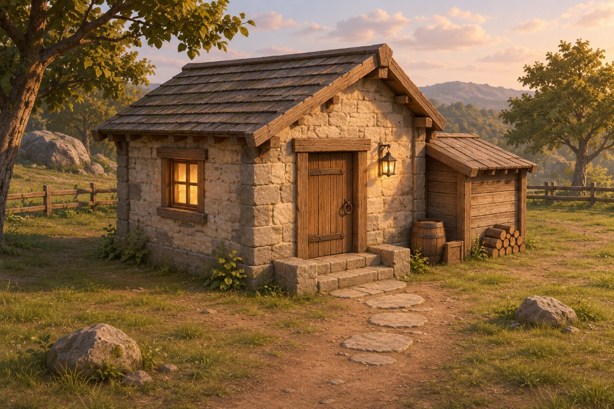
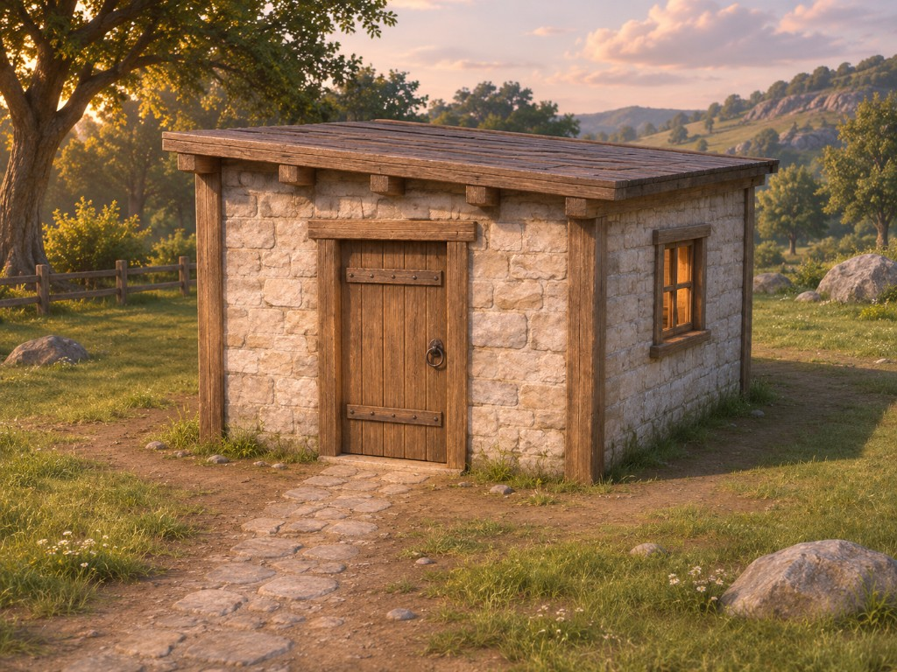

# Academy — Practice Homestead (expert demo script)

**Status: DRAFT for designer review — end-state visual locked.** Not implemented yet.  
**Goal:** Watching Tour should feel like an expert building something nice — a homestead you **grow into**, not a 187-tip feature catalog.

## Visual targets

### End state (build toward this)

Also mirrored as `practice-cottage-target.jpg` for older links.

**Reads as:** main stone room + wood gable roof · front door with **stone steps** · glowing front window · wall lantern · **lean-to annex** with barrel/crate/wood · dirt path + stepping stones · soft golden hour. Tree/fence/hills = mood backdrop (elective / light set-dressing only).

### Stage 1 silhouette (optional earlier ref)

Use as the “first shell” vibe before annex/steps/props — not a second Tour.

## Artifact (build into)

**Practice Homestead** — one continuous level, staged:

| Stage | What exists | Why (features earned) |
|-------|-------------|------------------------|
| A — Main shell | Floor, four walls, gable/shed roof | Floor/Wall/Ceiling, grid, move, focus |
| B — Openings + entry | Door, window, short stair/steps to door | Openings, stair/ramp |
| C — Annex | Lean-to volume on the side | Second brush volume, attach/align |
| D — Dress | Stone/wood materials, warm interior light + door lantern | Materials, lights |
| E — Yard | Path / stones, 1–2 props (barrel/crate) | Place meshes/props |
| F — Play | Spawn + Play walk-up the path into the door | Testing |

**In core (motivated by image):** stairs/steps, second volume (annex), materials, lights, path, props, Play.  
**Still elective:** carve/subtract (unless annex opening needs it), Meshy, Materials workspace deep dive, fog/PP curriculum, fence/tree hero props, layers/pivot/chrome dump.

Continuity: stages share one progressive world. Electives are **not** on Tour-all.  
Target watch time at **1×: ~15–20 min** (homestead is bigger than the tiny shed).

## Product shape

| Track | What it is | Tour |
|-------|------------|------|
| **Core** (~10–12 chapters, ~55–75 tips) | Expert builds the homestead in stages | Default **Tour** / Tour all |
| **Go deeper** | Optional topics after Play | Per-lesson Tour only |

Catalog: “Practice Homestead” first, then “Go deeper.”

## Core chapters

### 1. Look around
Empty pad · orbit · free-fly · Focus. No chrome laundry list.

### 2. Main floor and walls
Rectangle shell · Floor · Wall · grid · Move · Focus.

### 3. Roof the main room
Gable-friendly ceiling/roof brushes · orbit to show enclosure.

### 4. Door, window, steps
Front door + glowing window opening · **stair/steps** up to the door (matches image).

### 5. Lean-to annex
Side volume with slanted roof · place against the main wall · optional opening into main room if clean.

### 6. Dress stone and wood
Wall/roof/floor materials · stay in Level Editor.

### 7. Warm lights
Interior point light (window glow) · exterior lantern by the door if easy.

### 8. Path and yard props
Stepping stones / short path · barrel or crate by the annex (one or two props).

### 9. Play
Player spawn on the path · Play · walk to door · Stop · “homestead done.”

### Optional coda (2–3 tips)
Soft golden-hour sky/ambient **or** light fog — not full atmosphere lessons. Fence/tree = skip or one elective tip max.

## Electives (“Go deeper”)

Workspace chrome · sticky notes/checklists · layers · geometry edit / surface align / pivot · subtractive carve (full) · multilevel beyond steps · columns/arches · environmental heroes (tree, fence, water) · native geometry / static meshes / asset tools · Project Art / Meshy · materials shading / textures · world environment / fog / PP (full) · advanced lighting.

## Tour behaviour (when implemented)

- Tour-all = homestead core only.
- Continuous world across core chapters.
- Tips narrate; execution builds; tip never covers the control/action.
- Never auto-click Record / Save / spend / generate.

## Migration plan (after approval)

1. Freeze this script.  
2. Re-author core lessons + progressive starters.  
3. Catalog + Tour-all → core ids.  
4. Acceptance, tests, tip-count hint.  
5. Keep homestead (+ stage1) images under `docs/assets/`.

## Designer checks

- [x] End-state image — **this homestead**
- [x] Bigger build-into — **main + steps + annex + path/props**
- [x] Stairs — **in core** (entry steps)
- [x] Carve — **optional** only if annex needs an interior opening; else elective
- [ ] Annex as brushes only vs brush + placed wood props?
- [ ] Lantern as light actor vs emissive mesh prop?
- [ ] Golden-hour coda in core Play chapter or elective?
- [x] Watch time — **~15–20 min at 1×**

## Out of scope

- Photoreal landscape fidelity in Tour  
- Matching every tree/fence board  
- Paid generation in Tour  
- Rewriting all elective copy up front  
